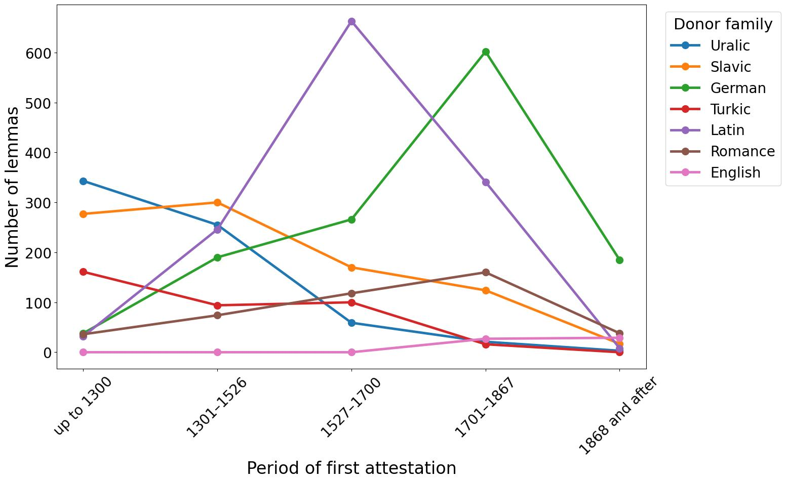
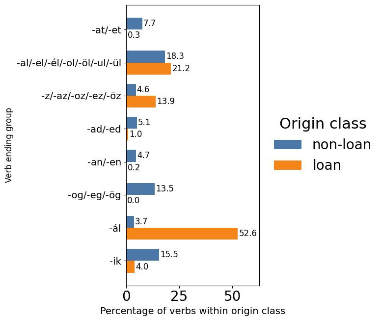

# Hungarian Loanword Detection

Machine-learning pipeline for detecting loanwords in Hungarian, built for my master's thesis
*Detecting Loanwords in Hungarian: A Machine Learning Approach*
(MSc in Informatics: Language Technology, University of Oslo, 2026).

The project turns a scanned etymological dictionary (ÚESz, *Új magyar etimológiai szótár*) into a
structured lexical database of 9,860 dictionary articles, which expand to 13,191 subentries because
word-family articles contain several headwords each. The database is then enriched with
phonological, morphological and semantic features, and logistic-regression classifiers are trained
to predict whether a Hungarian word is a loanword, and if so, from which donor-language family.

## What the pipeline does

```
ÚESz PDF ──► marked text ──► structured JSON entries ──► etymology CSV
                                                              │
              feature enrichment ◄────────────────────────────┘
              • IPA transcription (phonemizer / eSpeak NG)
              • phoneme n-grams + vowel-pattern features
              • articulatory features
              • POS tagging (emMorph via HFST)
              • semantic fields (OdeNet / Princeton WordNet)
                                                              │
              logistic-regression experiments ◄───────────────┘
              • binary: loanword vs. native
              • multinomial: donor-language family (9 classes)
              • feature ablation, error analysis, surface-form stress tests
```

Everything is plain Python (pandas, scikit-learn) organized as importable helper modules
(`helpers/`, ~12,000 lines) plus three notebooks that run extraction, morphology audit and
classification end to end via `run_pipeline.py`.

## Results

**Binary loanword detection** (11,211 lemmas, stratified 5-fold CV):

| Feature set              | Accuracy | Macro F1 |
|--------------------------|---------:|---------:|
| Majority baseline        |    0.558 |    0.358 |
| Phoneme n-grams          |    0.828 |    0.827 |
| + vowel patterns         |    0.832 |    0.830 |
| + articulatory features  |    0.833 |    0.831 |
| + part of speech         |    0.851 |    0.849 |
| + semantic fields (full) |**0.853** |**0.851** |

**Multinomial donor-family classification** (9 classes, 11,211 lemmas, 5-fold CV):

| Feature set              | Accuracy | Macro F1 |
|--------------------------|---------:|---------:|
| Majority baseline        |    0.442 |    0.068 |
| Phoneme n-grams          |    0.580 |    0.380 |
| Full feature set         |**0.603** |**0.399** |

The phonological signal alone carries most of the binary decision, since loanwords tend to sound
different. By contrast, donor-family attribution is much harder and benefits more from POS and
semantic features.

Aggregate statistics from the extracted database:

| | |
|---|---|
|  |  |

### Why these donor groups and periods

The period boundaries are historical rather than linguistic. They mark events
that changed the political and social environment in which borrowing happened.

**Up to 1300** covers the earliest written period and roughly corresponds to
the age of the Árpád dynasty, which ended with the death of Andrew III in 1301.
**1526** is the Battle of Mohács and the end of the medieval Kingdom of Hungary
as a unified independent state. **1700** reflects the end of Ottoman rule over
most of historical Hungary after the Treaty of Karlowitz in 1699, and the
beginning of stronger Habsburg consolidation. **1867** is the Austro-Hungarian
Compromise, which created the Dual Monarchy.

The donor groups follow the same history. Indo-Iranian and Turkic contact
predates the Hungarian settlement of the Carpathian Basin around 895 to 900.
Slavic influence grows after the settlement, especially in vocabulary connected
with agriculture and settled life. Latin is a special case, since it was the
written language of church, law and administration and remained official in
Hungary until 1844. German enters first through settlement, towns, trade and
mining, then dominates again under Habsburg administration between 1700 and
1867. Romance influence is tied to Italian and Latin cultural contact, and
English borrowing is largely a twentieth-century layer.

This matters for classification because older borrowings are usually more
integrated. Early Turkic, Slavic and Indo-Iranian loans often behave like
inherited vocabulary, which is exactly what the recall figures below show.

One caveat applies throughout. The periods refer to the year of **first
attestation in ÚESz**, not necessarily to the year a word actually entered
Hungarian.

### Where the classifier struggles

The full model was broken down by part of speech, donor family and first
attestation period. Values are means across the five folds, with standard
deviations after the plus-minus sign, and n is the average number of true
target-class items per fold.

**By part of speech** (+art, the strongest configuration without explicit POS features):

| POS | Non-loan F1 | Loan F1 |
|---|---|---|
| verb | 0.94 ±0.00 (n=455) | 0.77 ±0.01 (n=120) |
| noun | 0.64 ±0.02 (n=297) | 0.86 ±0.01 (n=913) |
| adj_adv | 0.82 ±0.04 (n=118) | 0.82 ±0.03 (n=113) |

Nouns dominate the loanword class and verbs the non-loan class, so the
classifier is strongest exactly where phonology and class distribution agree.

**Loanword recall by donor family** (full model):

| Donor family | Recall |
|---|---|
| international | 0.96 ±0.02 (n=214) |
| Latin | 0.95 ±0.01 (n=289) |
| wanderword | 0.90 ±0.04 (n=49) |
| English | 0.88 ±0.06 (n=28) |
| German | 0.86 ±0.02 (n=284) |
| Romance | 0.85 ±0.03 (n=90) |
| Slavic | 0.79 ±0.03 (n=191) |
| Turkic | 0.56 ±0.07 (n=81) |
| Indo-Iranian | 0.54 ±0.13 (n=10) |

Turkic and Slavic loans are the hardest to recover. They entered Hungarian
early and adapted to its phonology, which leaves little for an IPA-based
classifier to detect.

Age alone does not explain the pattern, though. Wanderwords are early too, yet
reach 0.90. Several of them are cultural or material terms that travelled
through a number of European languages, such as *topáz* (1208), *kristály*
(1416) and *rubin* (1478). Words like these may have circulated in literate,
commercial or otherwise multilingual settings, which could have preserved more
of their donor-language shape. That is an interpretation rather than something
the data here can demonstrate.

**By first attestation period** (full model):

| Period | Non-loan F1 | Loan F1 |
|---|---|---|
| up to 1300 | 0.78 ±0.03 (n=145) | 0.72 ±0.03 (n=125) |
| 1301-1526 | 0.85 ±0.00 (n=262) | 0.80 ±0.02 (n=210) |
| 1527-1700 | 0.86 ±0.02 (n=237) | 0.89 ±0.01 (n=313) |
| 1701-1867 | 0.85 ±0.02 (n=325) | 0.90 ±0.01 (n=466) |
| 1868 and after | 0.63 ±0.09 (n=22) | 0.93 ±0.00 (n=123) |

Loanword detection improves steadily over time. The non-loan score drops
sharply after 1868, but that group has only 22 items per fold, and several of
them are modern coinages with loan-like shapes.

**Which donor families get confused** (row-normalised, full multinomial model,
diagonal is recall in percent):

| True class | Recall | Most common confusion |
|---|---|---|
| non-loan | 76.5 | Slavic 5.5, Turkic 5.9 |
| Latin | 63.9 | international/wanderword 14.3 |
| German | 52.3 | international/wanderword 12.1 |
| Slavic | 50.0 | non-loan 12.7 |
| international/wanderword | 43.8 | Latin 17.7 |
| Turkic | 31.9 | non-loan 28.0 |
| English | 24.6 | German 26.8, international 21.8 |
| Romance | 18.6 | international 20.4, German 17.5 |
| Other loan | 8.5 | non-loan 28.7, Slavic 21.7 |

The confusions are linguistically sensible rather than random. English is
pulled toward German and the international class, Turkic toward non-loan
because those borrowings are old and fully integrated, and Latin toward the
international group it historically fed.

## A note on data availability

The source dictionary (ÚESz) is copyrighted. **This public repository therefore contains the
complete code but none of the dictionary-derived data**. This means no PDFs, no extracted JSON
entries, no enriched CSVs, and the notebooks are published with their outputs cleared. With
authorized access to the ÚESz PDFs, the entire database can be rebuilt from scratch with
`python run_pipeline.py`.

The one dataset included, `input_files/wiktionary_hu_borrowed_from_english_manually_grouped.csv`,
is derived from [Wiktionary](https://www.wiktionary.org/) (CC BY-SA) and manually grouped by me.

### Getting the dictionary PDFs

The ÚESz PDFs are freely downloadable from **ÚESzWeb**
(<https://uesz.nytud.hu/downloads.html>). The page is in Hungarian and has
two columns, and you need every file from both.

Under **Szótár** you will find the 32 per-letter volumes, from *ÚESz - A, Á*
through *ÚESz - Zs*. Under **Segédletek** you will find the nine front-matter
files, starting with *Előszó* and ending with *Bibliográfia*. Click the
**PDF Letöltése** button on every row in both columns.

Place all 41 files, **with their original filenames unchanged**, into the
folder below. Create it if it does not exist.

```
uesz_extract/uesz_pdf/
```

The pipeline picks up every `*.pdf` in that folder, so the front matter and the per-letter volumes
are all processed together:

```
uesz_extract/uesz_pdf/
├── 1_uesz_eloszo.pdf          9 front-matter PDFs
├── ...                        (preface, guide, abbreviations, symbols, …)
├── 9_uesz_bibliografia.pdf
├── uesz-A.pdf                 32 per-letter volumes
├── uesz-B.pdf
├── ...
└── uesz-ZS.pdf
```

Then run `python run_pipeline.py`. The marked text, the 9,860 structured JSON entries and the
enriched CSVs are regenerated into `uesz_extract/uesz_output/`, which is git-ignored. Nothing
derived from the dictionary is ever committed.

The dictionary text remains the property of the Hungarian Research Centre for Linguistics
(Nyelvtudományi Kutatóközpont); this repository only provides the code that processes it.

## Repository structure

- `helpers/`: all Python modules, covering PDF-to-text conversion, entry segmentation, etymology
  parsing (`etymology_parser.py`, 3,300 lines of structured parsing of natural-language etymology
  descriptions), feature enrichment, and classification.
- `uesz_extract/01_pdf_to_txt_to_json_to_csv.ipynb`: extraction and enrichment pipeline.
- `emmorph_audit/02_emmorph_test.ipynb`: audit of emMorph's ability to recover dictionary base
  lemmas from derivational forms.
- `classification/03_log_reg_classification.ipynb`: all classification experiments, ablations
  and error analyses.
- `run_pipeline.py`: executes the three notebooks in order, and run copies land in `pipeline_runs/`.
- `docs/figures/`: selected aggregate figures from the thesis.

## External dependencies

Beyond `pip install -r requirements.txt` (tested with Python 3.10), the full pipeline needs:

- **HFST + emMorph** for Hungarian morphological analysis: install the `hfst` command-line tools
  and obtain the compiled Hungarian transducer (`hu.hfstol`) from the
  [emMorph project](https://github.com/nytud/emMorph); point `HFST_LOOKUP` at `hfst-lookup` if it
  is not on `PATH`. The transducer is not redistributed here.
- **eSpeak NG** for IPA transcription via `phonemizer`.
- **WordNet resources** for semantic fields: `python -m wn download odenet:1.3 omw-en31:1.4`

## License

Code is MIT-licensed (see `LICENSE`). The Wiktionary-derived CSV is CC BY-SA.
